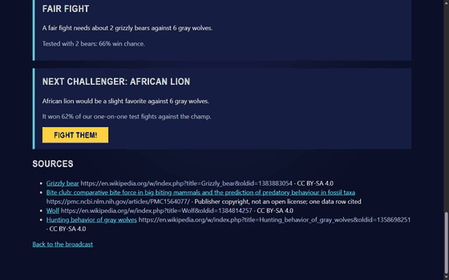

# The broadcast, recorded live (D07)

One full run of the broadcast against the live back end, recorded for D07 (#48). The fight plays at 3× speed; everything else is real time.

## The run

- **When:** Nov 16, 2026, on `main` at commit `7299ede`, started with `npm start` in live mode.
- **Matchup:** "a grizzly bear vs 6 gray wolves in a forest", picked from the home page examples, forest battlefield.
- **What it shows:** the home page, tonight's card, the loading ticker with stage updates, the intro with captions, the fight, the "6 GRAY WOLVES WIN!" banner, and the results page with the stat sheets, source tags, fair fight, and next challenger.
- **Recorded with:** headless Microsoft Edge at 1280×800 over the DevTools protocol, scaled to 560×350 for the GIF.

## Stages

| Stage | Status |
|---|---|
| intake, research, simulate, summary, challenger, images | done (live) |
| script | fallback: "Some of the commentary used the template script this time." |
| audio | fallback: "Captions only this time, no announcer voice." |
| music | fallback: "No music this time." |

The three fallbacks are the degraded modes D07 handles: the page shows "Some effects unavailable" and plays the show with captions. The announcer voice and music come from A07 (#45). A GIF has no sound, so this recording doesn't need them.
