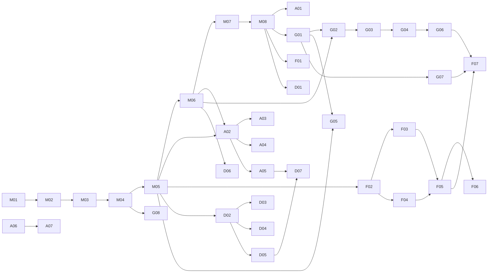

# Lanes, Waves, and Dependencies

Five lanes, one per person, sized to similar effort. **S = 1 point (a few hours), M = 2 points (about a day).** Nothing is size L; anything that grows past M gets split with `/new-issue`.

| Lane | Owner | Focus | Tasks | Points |
|---|---|---|---|---|
| 1 | **Mike Lippert** (PM) `mlip3191` | Foundation & platform: repo, guardrails, skeleton, contracts, providers, review tooling | M01–M08 | 14 |
| 2 | **Adam Fondale** `afondale` | Intake, safety & orchestration: parsing, clarifying, moderation, pipeline, announcer script + voice | A01–A07 | 13 |
| 3 | **Gunnar O'Connor** `gunnaroc` | Research & knowledge base: sources, ingestion, retrieval, stat sheets, traceability, benchmark data, Docker | G01–G08 | 13 |
| 4 | **Felipe Cervino** `felcervino` | Simulation & analytics: engine, numbers/size, terrain/behavior, stats, fair fight, benchmark runner | F01–F07 | 13 |
| 5 | **Dillon Smart** `dilloncsmart` | Front end & battle stage: onboarding, app shell, intake UI, results, Phaser scene, images, broadcast page | D01–D07 | 13 |

Mike's lane is one point higher because Phase 0 has to happen before anyone else can start; in exchange, Mike has no Wave 2–4 build tasks and spends that time reviewing and integrating.

Each teammate's **first task (Wave 1) is a setup task** that also teaches the workflow: Adam builds the issue system, Gunnar plans the sources, Felipe writes the review guide and does the first review, Dillon builds onboarding and the setup checker.

## Waves

| Wave | When (suggested) | Mike | Adam | Gunnar | Felipe | Dillon |
|---|---|---|---|---|---|---|
| 0 — Foundation | Mon Nov 9 – Tue Nov 10 | M01 → M08 | — | — | — | — |
| 1 — Onboard + setup | Wed Nov 11 | review, unblock | A01 | G01 | F01 | D01 |
| 2 — Skeleton | Thu Nov 12 – Sat Nov 14 | review | A02, A04 | G02, G05, G07 (start) | F02, F03 | D02, D03 |
| 3 — Core | Sun Nov 15 – Tue Nov 17 | review, integration checks | A03, A05 | G03, G04 | F04, F05 | D04, D05 |
| 4 — Complete MVP | Wed Nov 18 – Fri Nov 20 (feature freeze end of day) | review, demo prep | A06, A07 | G06, G07, G08 | F06, F07 | D06, D07 |

**Due Wednesday, November 25** (DECISIONS D-05). That leaves about ten working days for 66 points, roughly one M task every day and a half per person, so the schedule has no slack.

**Cut order if we're behind** (check at MS-1 on Nov 14 and MS-2 on Nov 17). Cut from the top; the app still works with captions and placeholder sprites:
1. Music generation (keep the announcer voice) — part of A07
2. G08 Docker (use `npm run setup` + `npm run dev` for the demo and the instructor)
3. D06 generated sprites (placeholders already exist in D05)
4. A07 voice (captions carry the narration)
5. F07 benchmark reduced to the 15 "obvious" matchups
6. G05 hand-verified sheets reduced from 15 to the 5 showcase fighters

## Integration milestones

| Milestone | Proves | Needs |
|---|---|---|
| **MS-1 Walking skeleton** (Sat Nov 14) | Type a matchup in the UI → see a verdict from mocks and stubs | M04–M06, A02, A05 stub path, F02, D02, D03 |
| **MS-2 Real brain** (Tue Nov 17) | Real stat sheets with sources + real simulation in the UI | G04, F03–F05, D04, A05 |
| **MS-3 The show** (Fri Nov 20) | Announcer, music, sprites, animation; benchmark baseline | A06, A07, D05–D07, F06, F07 |
| **MS-4 Demo-ready** (Sun Nov 22) | Five pre-generated showcase battles, Docker run on both OSes, backup video | G08, everyone |

## Dependency graph

## Cross-lane contracts (who depends on whose output)

| Producer | Contract | Consumers |
|---|---|---|
| Mike M05 | all models in `backend/app/models/` | everyone |
| Mike M06 | provider interfaces + mocks | Adam, Gunnar, Dillon (D06) |
| Adam A02/A03 | `IntakeResult`, `/api/intake` | Dillon D03 |
| Adam A05 | `BattleRecord`, `/api/battles`, SSE | Dillon D07 |
| Gunnar G04 | `StatSheet`, `/api/fighters` | Felipe (all), Adam A05/A06, Dillon D04 |
| Felipe F02–F06 | `SimulationResult`, `FairFight`, `ChallengerSuggestion` | Adam A05/A06, Dillon D04/D05 |
| Adam A06 | `Script` with `at_event` | Dillon D07, Adam A07 |
| Adam A07 / Dillon D06 | `Asset` | Dillon D05/D07 |

Until a producer's task lands, consumers use the contract fixture in `backend/tests/fixtures/contracts/` (backend) or `frontend/src/fixtures/` (front end). That is why nobody waits.

## Review pairing (who reviews whom by default)

Anyone can review anything, but to spread knowledge and keep reviews fast, the default reviewer is:

| Author | Default reviewer | Why |
|---|---|---|
| Adam | Dillon | Dillon consumes the intake + battle APIs |
| Gunnar | Felipe | Felipe consumes stat sheets |
| Felipe | Gunnar | Gunnar's benchmark checks Felipe's engine |
| Dillon | Adam | Adam's APIs feed the UI |
| Mike | rotating | everyone sees the platform code |

Critical-file changes from anyone except Mike also need Mike's approval (enforced by the "Critical files approval" check). Everyone except Mike is on Windows, so Mike also checks on Mac any PR that touches setup scripts, hooks, Docker, or file paths.

Final deliverables (deck sections, user guide, submission) are split one owner per section in [DELIVERABLES.md](DELIVERABLES.md).
