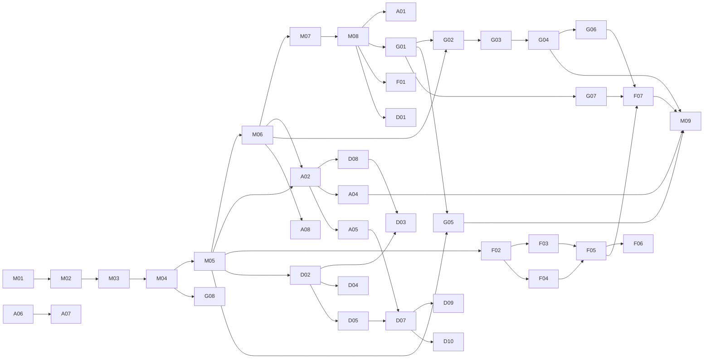

# Lanes, Waves, and Dependencies

Five lanes, one per person, sized to similar effort. **S = 1 point (a few hours), M = 2 points (about a day).** Nothing is size L; anything that grows past M gets split with `/new-issue`.

| Lane | Owner | Focus | Tasks | Points |
|---|---|---|---|---|
| 1 | **Mike Lippert** (PM) `mlip3191` | Foundation & platform (Phase 0), then integration, reviews, and the live AI evaluation | M01–M09 | 16 |
| 2 | **Adam Fondale** `afondale` | Intake, safety & orchestration, plus all generated media: announcer script, voice, music, sprites | A01, A02, A04–A08 | 14 |
| 3 | **Gunnar O'Connor** `gunnaroc` | Research & knowledge base: sources, ingestion, retrieval, stat sheets, hand-verified sheets, traceability, benchmark data, showcase battles | G01–G08 | 13 |
| 4 | **Felipe Cervino** `felcervino` | Simulation & analytics: engine, numbers/size, terrain/behavior, stats, fair fight, benchmark runner | F01–F07 | 13 |
| 5 | **Dillon Smart** `dilloncsmart` | Front end, battle stage & user experience: onboarding, app shell, intake + clarifying question, results, Phaser scene, broadcast page, user guide, usability testing | D01–D05, D07–D10 | 14 |

Mike's lane is higher because Phase 0 must happen before anyone else can build. After Phase 0 his only build task is M09, the live AI evaluation, which he runs because he didn't build the research pipeline it measures. Teammates are invited early (M02) so they can install and read while Mike finishes. **Gunnar is Mike's backup approver** for critical-file PRs (DECISIONS D-31).

Each teammate's **first task (Wave 1) is a setup task** that also teaches the workflow: Adam builds the issue system, Gunnar plans the sources and the assumption rubric, Felipe writes the review guide and does the first review, Dillon builds onboarding and the setup checker.

## Schedule (code complete Wednesday, November 25)

The slide deck and presentation are prepared outside this repo, starting Nov 25 (DECISIONS D-05).

| Wave | Dates | Mike | Adam | Gunnar | Felipe | Dillon |
|---|---|---|---|---|---|---|
| 0 — Foundation | Mon Nov 9 – Tue Nov 10 | M01 → M08 | install, read | install, read | install, read | install, read |
| 1 — Onboard + setup | Wed Nov 11 | review, unblock | A01 | G01 | F01 | D01 |
| 2 — Skeleton | Thu Nov 12 – Sat Nov 14 | review | A02, A04 | G02, G05 (5 showcase fighters), G07 | F02, F03 | D02, D03 |
| 3 — Core | Sun Nov 15 – Tue Nov 17 | review, integration checks | A05, A06 | G03, G04 | F04, F05 | D08, D04, D05 |
| 4 — Complete | Wed Nov 18 – Fri Nov 20 | M09 evaluation, review | A07, A08 | G05 (remaining 10), G06, G08 | F06, F07 | D07 |
| 5 — Test + polish | Sat Nov 21 – Sun Nov 22 | bug bash, triage | bug bash, fixes | bug bash, fixes | bug bash, fixes | D10 usability sessions, D09 user guide |
| Freeze + fix | **Feature freeze end of Sun Nov 22**; fixes Mon Nov 23 – Tue Nov 24 | final README, export | fixes | fixes | fixes | fixes |
| Code complete | **Wed Nov 25** | tag `v1.0`, export (DELIVERABLES) | — | — | — | — |

**Cut order if we're behind** (check at MS-1 on Nov 14 and MS-2 on Nov 17). Cut from the top; the app still works with captions and placeholder sprites:
1. Music generation (keep the announcer voice) — part of A07
2. A08 generated sprites (placeholders already exist in D05)
3. A07 voice (captions carry the narration)
4. F07 benchmark reduced to the held-out set plus the 15 "obvious" matchups
5. G05 hand-verified sheets reduced from 15 to the 5 showcase fighters (M09's extraction check then uses 5)

Never cut: M09's evaluation, D09's user guide, D10's usability sessions, or the fresh-clone check in G08. They're what the course grades beyond "it runs."

## Integration milestones

| Milestone | Proves | Needs |
|---|---|---|
| **MS-1 Walking skeleton** (Sat Nov 14) | Type a matchup in the UI → see a verdict from mocks and stubs | M04–M06, A02, A05 stub path, F02, D02, D03 |
| **MS-2 Real brain** (Tue Nov 17) | Real stat sheets with sources + real simulation in the UI | G04, F03–F05, D04, A05 |
| **MS-3 The show** (Fri Nov 20) | Announcer, music, sprites, animation; benchmark baseline | A06–A08, D05, D07, F06, F07 |
| **MS-4 Demo-ready** (Sun Nov 22) | Five showcase battles in `data/showcase/`, `npm start` from a fresh clone on Windows and Mac, evaluation written | G08, M09, everyone |

## Dependency graph

## Cross-lane contracts (who depends on whose output)

| Producer | Contract | Consumers |
|---|---|---|
| Mike M05 | all models in `backend/app/models/` | everyone |
| Mike M06 | provider interfaces + mocks | Adam, Gunnar |
| Adam A02 | `IntakeResult` parsing, incl. `size_reference` | Dillon D08/D03, Felipe F03 |
| Dillon D08 | `/api/intake` endpoints | Dillon D03 |
| Adam A05 | `BattleRecord`, `/api/battles`, SSE | Dillon D07 |
| Gunnar G04 | `StatSheet`, `/api/fighters` | Felipe (all), Adam A05/A06, Dillon D04 |
| Felipe F02–F06 | `SimulationResult`, `FairFight`, `ChallengerSuggestion` | Adam A05/A06, Dillon D04/D05 |
| Adam A06 | `Script` with `at_event` | Dillon D07, Adam A07 |
| Adam A07 / A08 | `Asset` | Dillon D05/D07 |

Until a producer's task lands, consumers use the contract fixture in `backend/tests/fixtures/contracts/` (backend) or `frontend/src/fixtures/` (front end). That is why nobody waits.

## Review pairing (who reviews whom by default)

Anyone can review anything, but to spread knowledge and keep reviews fast, the default reviewer is:

| Author | Default reviewer | Why |
|---|---|---|
| Adam | Dillon | Dillon consumes the intake + battle APIs |
| Gunnar | Felipe | Felipe consumes stat sheets |
| Felipe | Gunnar | Gunnar's benchmark checks Felipe's engine |
| Dillon | Adam | Adam's APIs and media feed the UI |
| Mike | rotating | everyone sees the platform code |

Critical-file changes from anyone except Mike also need Mike's approval, or Gunnar's when Mike is unavailable (enforced by the "Critical files approval" check). Everyone except Mike is on Windows, so Mike also checks on Mac any PR that touches setup scripts, hooks, the start command, or file paths.

Repository deliverables due by Nov 25 (README, user guide, runnable code, export) are in [DELIVERABLES.md](DELIVERABLES.md).
