# Battle Royale user guide

This guide is for someone who has never seen the app, and maybe never used a terminal. It takes about 20 minutes the first time, mostly waiting for installs.

**Contents:** [1. What it is](#1-what-the-app-does) · [2. Run it](#2-run-it-on-your-computer) · [3. Use it](#3-use-it) · [4. What it won't do](#4-what-it-wont-do) · [5. Troubleshooting](#5-troubleshooting)

---

## 1. What the app does

You name two sides of an imaginary fight, like *"a grizzly bear vs 6 gray wolves in a forest"*. The app looks up each fighter in vetted sources (mostly Wikipedia and published studies) and builds a stat sheet, then runs the fight about 1,000 times in a simulation to decide who usually wins. It plays the result as a corny late-night sports broadcast, then shows the full results with every source.

**What "science-backed" means here:**

- **Sourced stats.** Every number on a stat sheet links to the page it came from, along with the exact quote. An AI model may copy a number only together with that quote, and code checks that the number really is in it.
- **Labeled guesses.** When no source gives a number, the app uses a default for that kind of fighter and tags it **estimate**. Traits that no source measures (aggression, armor, teamwork) are tagged **assumption** and come from a written scale.
- **Code decides the winner.** A simulation written in plain code picks the winner, not an AI model. The same matchup always gives the same result.

## 2. Run it on your computer

The app runs on your own computer and opens in your web browser. It works the same on Windows and Mac. You need an internet connection.

**Opening a terminal:** a terminal is a window where you type commands.

- **Windows:** press the Windows key, type **PowerShell**, and press Enter.
- **Mac:** press Cmd+Space, type **Terminal**, and press Enter.

Type each command below exactly, then press Enter, and wait for it to finish before typing the next one.

> **Windows tip:** if PowerShell says *"running scripts is disabled on this system"* when you type `npm`, type `npm.cmd` instead of `npm` in every command (for example `npm.cmd start`). See [Troubleshooting](#5-troubleshooting).

### Step 1: Install Node 26 and uv

Node runs the web page, and uv runs the Python back end (it installs the right Python for you).

| | Windows | Mac |
|---|---|---|
| **Node 26** | Download the installer from [nodejs.org](https://nodejs.org) and click through it. On the "Tools for Native Modules" screen, leave the box **unchecked**. | Download the installer from [nodejs.org](https://nodejs.org), or `brew install fnm` then `fnm install 26` |
| **uv** | `winget install astral-sh.uv` | `brew install uv` |

**Close the terminal and open a new one** so it finds the new programs. Then check both:

```bash
node --version
```

```bash
uv --version
```

You should see `v26` and a uv version number:

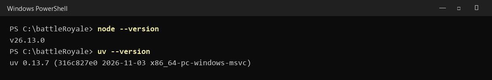

### Step 2: Get the code

Either download it or clone it:

- **Download:** on the project's GitHub page, click the green **Code** button, then **Download ZIP**. Unzip it somewhere easy, like your Documents folder.
- **Clone (if you have Git):** `git clone https://github.com/mlip3191/battleRoyale.git`

Then move the terminal into that folder. Type `cd ` (with a space), drag the folder from File Explorer or Finder onto the terminal window, and press Enter.

### Step 3: Connect the course AI endpoints (optional)

The app uses AI models provided by the course. Skip this step to try the app in **mock mode**: it runs with built-in sample data and needs no endpoints or key. The fights are still real simulations, but the fighters' stats, pictures and commentary are stand-ins.

To use the real AI endpoints, run:

```bash
npm run env:setup
```

It asks two questions. Paste in the **course host** and the **course API key** from the course endpoint list. The key stays hidden while you type or paste it. Your answers are saved only in a file called `.env` on your computer, and the app switches to live mode.

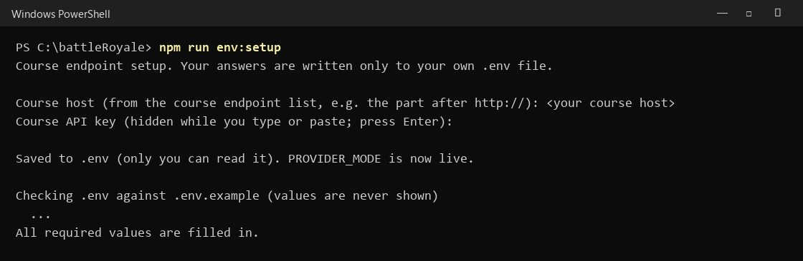

Never paste the key into a chat, an email, or a GitHub page. To check your settings later without showing them, run `npm run env:check`.

### Step 4: Install the app

```bash
npm run setup
```

This downloads everything the app needs. It takes a minute or two the first time. Warnings such as "packages are looking for funding" or "vulnerabilities" are normal and can be ignored.

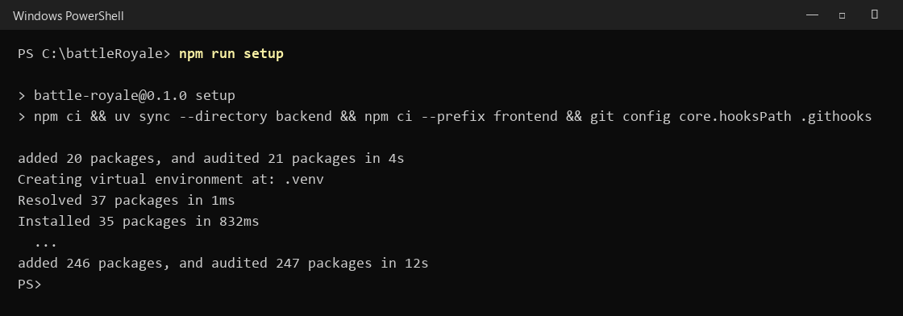

### Step 5: Start the app

```bash
npm start
```

Wait until you see **"Battle Royale is starting at http://localhost:8000"** and **"Application startup complete"**. Leave this window open: closing it stops the app.

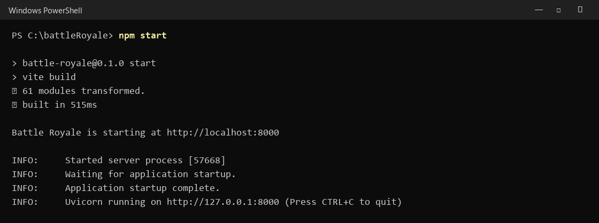

### Step 6: Open the app

Open your web browser (Chrome, Edge, Safari or Firefox) and go to **http://localhost:8000**.

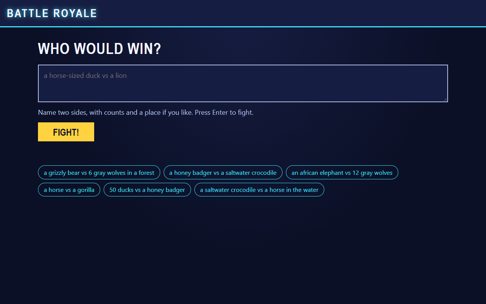

**To stop the app:** click the terminal window and press **Ctrl+C**. To start it again later, open a terminal in the same folder and run `npm start`. You don't need to repeat steps 1 to 4.

## 3. Use it

### Type a matchup

Type two sides into the box, with how many of each and, if you like, a place. Then press Enter or click **FIGHT!**. You can also click one of the example matchups under the box.

Good examples:

- `a grizzly bear vs 6 gray wolves in a forest`
- `100 duck-sized horses vs 1 horse-sized duck`
- `a honey badger vs a king cobra`
- `a saltwater crocodile vs a horse in the water`

Counts can be numbers or words ("a dozen house cats"), up to 10,000 per side. Size phrases like "horse-sized duck" work too: the app scales the duck up using both animals' real weights.

**Fighters that work best today:** the app has hand-checked stat sheets for 15 fighters: African elephant, African lion, bald eagle, bulldozer, duck, gorilla, gray wolf, grizzly bear, honey badger, horse, house cat, king cobra, main battle tank, Roman legionary, and saltwater crocodile. If you pick one it doesn't know yet, it says so and asks you to choose one of these.

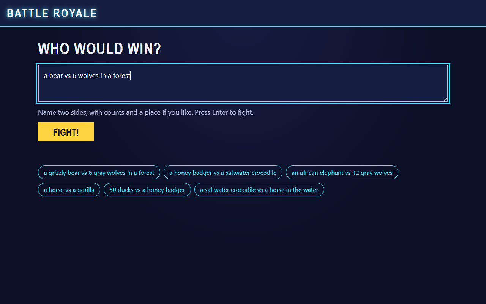

### Answer the quick question

If a fighter is vague, the app asks **one** question, such as *"Which type of bear would you like?"*. Click an answer, or type your own and click **Answer**. If your answer is still vague, the app picks the most common kind and tells you what it assumed.

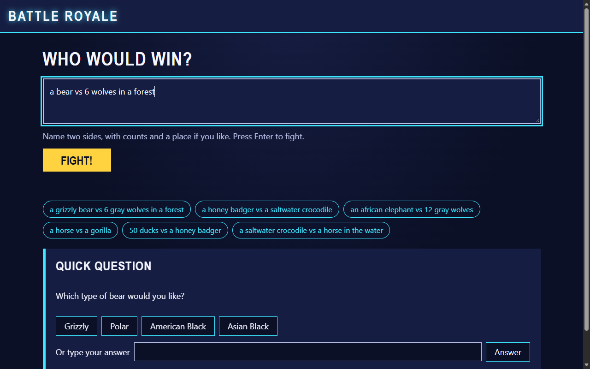

### Check tonight's card and pick a battlefield

The app shows how it read your matchup: each side, how many, and any assumptions it made. Pick a **Battlefield** from the list (arena, open field, forest, open water, shoreline, city streets or mountain), then click **FIGHT!** on the card.

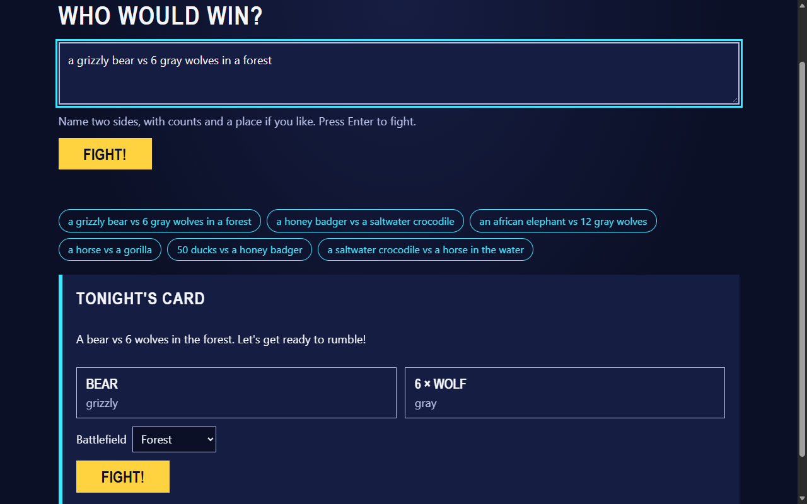

### Watch the broadcast

While the app researches and simulates, a ticker shows what it's doing and a list shows each step's progress. This usually takes under a minute.

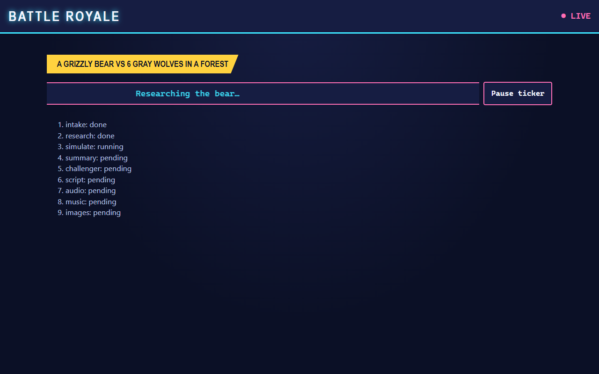

Then the show starts: the announcer introduces the fighters, with captions on screen. Click **Start the fight** when you're ready, or **Skip to verdict** to jump straight to the result. If a note says some effects are unavailable, the announcer voice or music couldn't be made this time; the captions and fight still work.

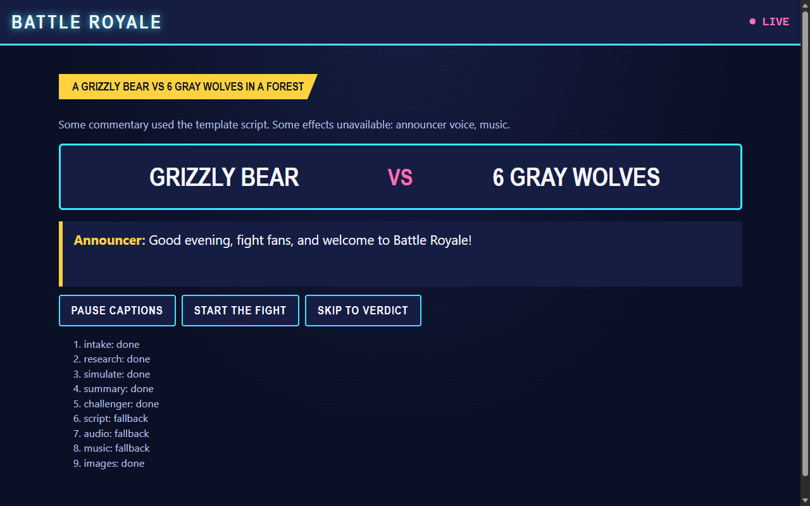

The fight replays one of the simulated fights. The floating minus numbers are damage from the simulation's own log. Use **Pause**, **1×** and **2×** to control the speed, or **Skip to end**. The sound controls (**Play sound**, **Mute** and a volume slider) control the announcer and music.

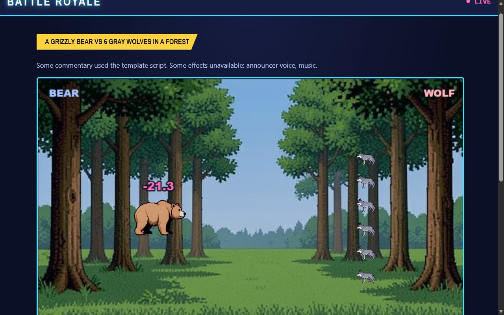

At the end, the verdict shows the winner, their win chance, and the reason in one line.

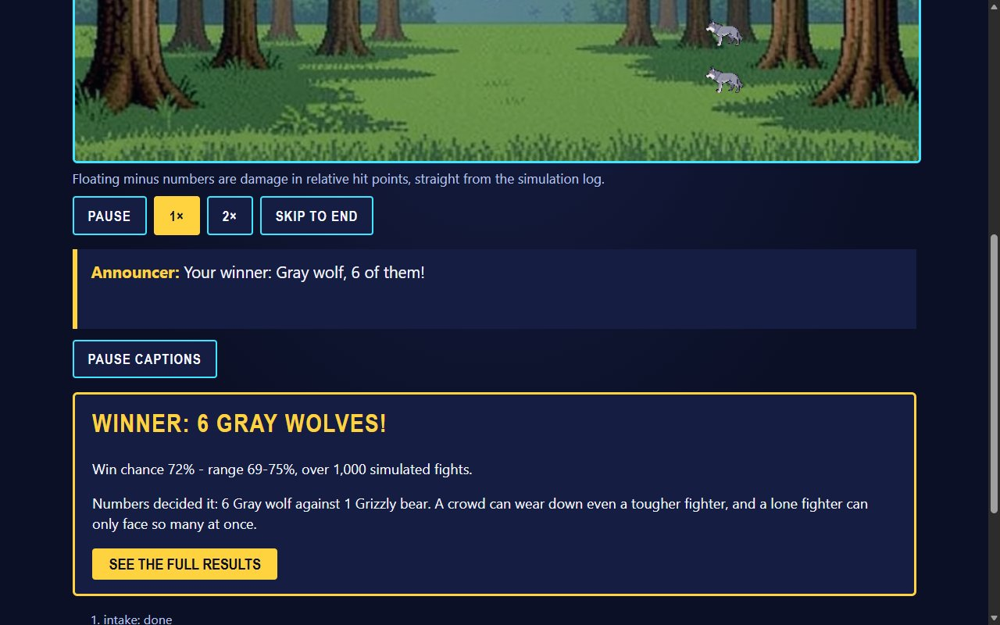

### Read the results page

Click **See the full results**. Each part, top to bottom:

- **Win chance and range.** For example "72% – range 69–75%". The app runs about 1,000 fights, and each one draws the fighters' stats from within their known range. The range shows how sure the result is, given how uncertain the stats are. It also shows how many fighters are usually left standing and how long fights last.
- **Deciding factor.** The one thing that mattered most, such as numbers, size, speed or armor. Code finds it by testing which stat changes the result most.

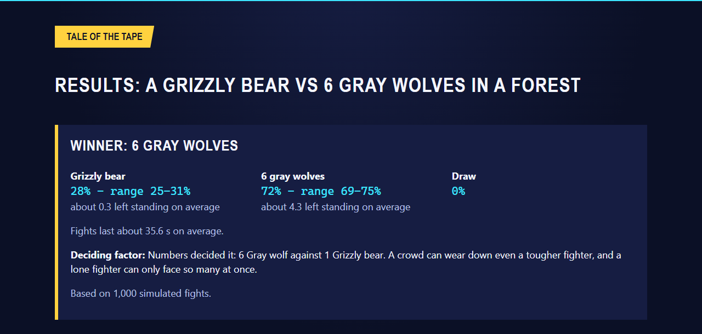

- **Tale of the tape.** One stat sheet per fighter. For each stat you see the value and where it comes from:
  - a **source link** with a confidence level and a short note from the source;
  - an **estimate** tag when no source had the number, so the app used a default for that kind of fighter;
  - a **derived** tag when code worked it out from other stats (for example, reach from size);
  - an **assumption** tag for traits no source measures, set from a written scale.

  A yellow "Heads up" banner warns you when many stats on a sheet are estimates or assumptions.

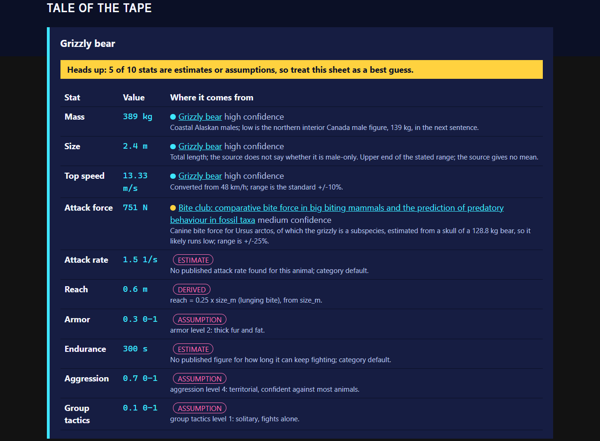

- **Fair fight.** How many of the losing side it would take to make the odds about even, for example "about 2 grizzly bears against 6 gray wolves". If no count up to 10,000 gets close, it says so.
- **Next challenger.** A suggested opponent for the winner. Click **Fight them!** to start that fight right away.
- **Sources.** Every page the stats came from, with links and licenses.

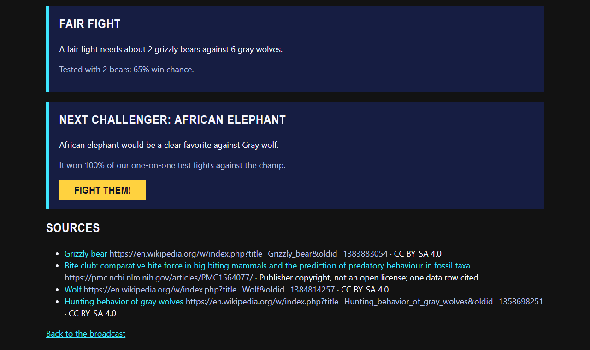

**Sharing:** the address in your browser's address bar reopens this result. It works on your own computer while the app is running.

### Showcase battles

Five ready-made battles show off what the app can do. When they're ready, they appear under **Showcase** on the home page:

1. 100 duck-sized horses vs 1 horse-sized duck
2. A grizzly bear vs 6 gray wolves in a forest
3. A honey badger vs a king cobra
4. A Roman legionary vs a gorilla in a forest
5. A dragon vs a main battle tank

## 4. What it won't do

The app politely turns some requests away, and tells you why:

| It won't use | Why | What you'll see |
|---|---|---|
| **Real people** (alive or historical) | It's not fair or kind to stage fights between real people. | "We keep real people out of the ring. Try a type of fighter instead, like a Roman legionary or a medieval knight." |
| **Named fictional characters** | They belong to their creators, and they have no real-world stats to look up. | "Named characters belong to their creators, so they can't step in. Try a creature type instead, like a dragon or a giant robot." |
| **Gods and deities** | No sources measure them, and they matter to many people. | "Gods are above our pay grade. Try a mythical creature, like a griffin, instead." |
| **Firearms and explosives** | The app keeps things PG. | "No firearms or explosives in this arena. Vehicles and machines are welcome, like a bulldozer." |
| **Groups of people** (nations, armies, teams) | Jokes are about the fighters, never about groups of people. | "We don't pit groups of people against each other. Pick an animal, a machine, or one fighter type like a Viking." |
| **Abstract ideas, places, landforms, planets** | They aren't physical fighters with measurable stats. | A message explaining what kinds of fighters work. |
| **More than two sides** | The arena only fits two sides for now. | It offers each pair as a two-sided matchup. Group a pack into one side, like "3 wolves". |
| **More than 10,000 on a side, or fractions** | It keeps the simulation fast and the fighters whole. | It lowers the count to 10,000 and says so on tonight's card, or asks how many whole fighters you meant. |

**What does work:** animals, historical fighter types (a Roman legionary, a medieval knight), objects, plants, vehicles and machines (a bulldozer, a tank), and mythical creature types (a dragon, a griffin). A mythical creature is modeled on the real animals its legends compare it to, and every one of its stats is tagged as an assumption.

The show is PG: knockouts and retreats, no blood or gore.

## 5. Troubleshooting

| Problem | Fix |
|---|---|
| **Windows: "running scripts is disabled on this system"** when you type `npm` | Type `npm.cmd` instead of `npm`, for example `npm.cmd run setup` and `npm.cmd start`. There's no need to change any Windows security settings. |
| **"'node' (or 'uv') is not recognized" / "command not found"** | Close the terminal and open a new one after installing, so it finds the new programs. If it still fails, install that program again (step 1). |
| **The page says "We couldn't reach the studio"**, or the browser says it can't connect to localhost:8000 | The app isn't running. Check that the `npm start` window is still open and shows "Application startup complete". If you closed it, run `npm start` again, then refresh the page (F5, or Cmd+R on Mac). |
| **"This fight was called off"** with "We don't have a stat sheet for … yet" | The app doesn't know that fighter yet. Pick one of the 15 fighters listed in [Type a matchup](#type-a-matchup), or click an example matchup. |
| **"Address already in use"** or port 8000 is busy when you run `npm start` | The app (or something else) is already running. Use the window where it's already running, or close it with Ctrl+C and run `npm start` again. Restarting the computer also clears it. |
| **The page looks old or a button does nothing after you update the code** | Stop the app with Ctrl+C, run `npm run setup` and then `npm start` again, and refresh the browser page. |
| **No announcer voice or music** | Sound is optional, and the captions always work. Click **Play sound**, check that **Mute** is off and your computer isn't muted. A note at the top of the broadcast says when a voice or music track couldn't be made this time. |
| **Everything looks like sample data** | You're in mock mode, which is fine for trying the app. To use the real AI endpoints, do [step 3](#step-3-connect-the-course-ai-endpoints-optional), then stop and restart the app. |

Still stuck? Run `npm run doctor`. It checks your computer's setup and says what to fix, without showing any secret values.
